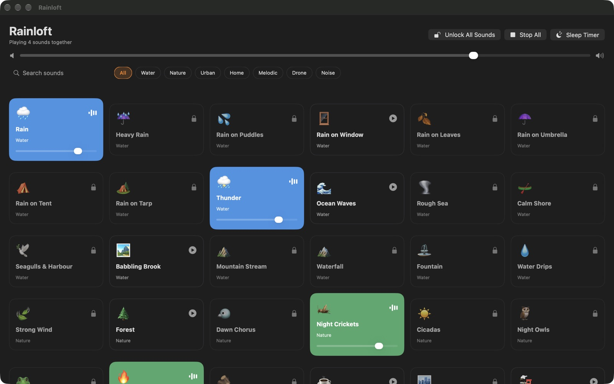

# Rainloft

Rain, sea, fire and night sounds for your Mac, made from real recordings and mixed however you like.

**Mac App Store** (coming soon) · [Website](https://perseus-sepahi.github.io/software/rainloft/) · [Support](https://perseus-sepahi.github.io/software/rainloft/support/)

## What it does

Rainloft plays 51 relaxing sounds that loop without a seam: rain on a window, a tent or an umbrella,
thunder, the sea, streams, a campfire, crickets and owls, a train or a coffee shop, a purring cat, a
fan, singing bowls and white, pink and brown noise. Almost all of them are cut from real field
recordings. Mix as many as you like, set each one's volume, and let the sleep timer fade them out.
A menu bar player starts and stops sounds without opening the window.

## Price

Free with 16 sounds, the mixer, the sleep timer and the menu bar player. A one-time US$0.99
purchase unlocks all 51 sounds in the same app. No subscription, no account.

## Privacy

No accounts, no analytics, no tracking, and no network connections of its own.
[Privacy policy](https://perseus-sepahi.github.io/software/rainloft/privacy/).

## Requirements

macOS 13 Ventura or later, Apple silicon or Intel.

## Reporting bugs

Open an [issue](https://github.com/perseus-sepahi/rainloft-app/issues). Include your macOS version,
the app version, and the steps that reproduce the problem.

## Source code

Rainloft is not open source. This repository holds the releases, the issue tracker and the
documentation only.

## Licence

See [LICENSE.md](LICENSE.md). The sound recordings and their licences are listed in
[THIRD-PARTY-NOTICES.md](THIRD-PARTY-NOTICES.md).

© 2026 Perseus Sepahi
